# System Architecture: AI-Based Deepfake Detection & Media Authenticity Analysis System

```mermaid
graph TD
    subgraph ClientLayer["Frontend Client (React + Vite)"]
        UI[User Interface & Dashboards]
        Dropzone[Media Ingestion & Drag-Drop]
        Viewer[Forensic Evidence Viewer]
        ReviewQ[Reviewer Queue]
        AdminView[Admin Oversight & Audit]
    end

    subgraph APILayer["Backend Gateway (FastAPI + Pydantic)"]
        AuthRouter["/api/auth (JWT & RBAC)"]
        MediaRouter["/api/media (Safe Decoding & Hashing)"]
        AnalysisRouter["/api/analysis (Inference Dispatch)"]
        ReviewRouter["/api/reviews (Status & Notes)"]
        ReportRouter["/api/reports (PDF & CSV Generation)"]
        AdminRouter["/api/admin (Metrics & Audits)"]
    end

    subgraph WorkerLayer["Asynchronous AI Forensic Engine"]
        Worker[Background Job Worker]
        ImageEngine[MesoInception-4 + ELA + 2D-FFT]
        VideoEngine[OpenCV Face Tracker + Temporal Pooling]
        AudioEngine[STFT Wiener Entropy + Vocoder Detector]
    end

    subgraph StorageLayer["Data & Evidence Storage"]
        DB[(PostgreSQL / SQLite via SQLAlchemy)]
        Uploads[Encrypted/Isolated Uploads]
        Thumbnails[Sampled Frame Thumbnails]
        Forensics[ELA Residuals & FFT Spectrums]
        Reports[Signed PDF & CSV Dossiers]
    end

    UI -->|REST API Requests| APILayer
    Dropzone -->|Multipart Upload| MediaRouter
    MediaRouter -->|SHA256 & Store| Uploads
    MediaRouter -->|Media Metadata| DB

    AnalysisRouter -->|Queue Job| DB
    AnalysisRouter -->|Dispatch Task| Worker
    Worker -->|Execute Pipeline| ImageEngine
    Worker -->|Execute Pipeline| VideoEngine
    Worker -->|Execute Pipeline| AudioEngine

    ImageEngine -->|Save ELA & FFT Artifacts| Forensics
    VideoEngine -->|Save Frame Thumbnails| Thumbnails
    Worker -->|Store Prediction & Indicators| DB

    Viewer -->|Fetch Evidence & Artifacts| StorageLayer
    ReviewQ -->|Submit Human Verdict| ReviewRouter
    ReviewRouter -->|Update Review Status| DB
    ReportRouter -->|Stream Dossier| UI
```

---

## 1. Modular Architectural Principles

### A. Separation of Probabilistic AI from Verified Ground Truth
Deep learning classifiers generate statistical likelihoods, not legal certainties. The system strictly isolates:
1. **AI Inference Predictions**: `likely_authentic`, `potentially_manipulated`, `inconclusive`, alongside continuous confidence scores (0.0 - 1.0) and uncertainty metrics.
2. **Human Review Determinations**: An independent record in `review_records` that can only be set or modified by authorized Forensic Reviewers or System Administrators.

### B. Defense-in-Depth File Ingestion
Uploaded media is treated as potentially malicious and unverified:
- Strict whitelist validation of MIME types (`image/jpeg`, `image/png`, `video/mp4`, `audio/wav`).
- Maximum upload size enforcement (100 MB).
- Immediate computation of cryptographic SHA-256 hashes to guarantee chain of custody.
- Random UUID-generated storage filenames preventing directory traversal attacks.

### C. Multi-Modal Forensic Approach
Instead of relying solely on a black-box convolutional network, DeepShield evaluates three orthogonal forensic domains:
1. **Spatial Domain**: Error Level Analysis (ELA) identifies JPEG resaving discrepancies between the spliced face and original background.
2. **Frequency Domain**: 2D Fast Fourier Transform (FFT) reveals periodic generative artifacts typical of GAN upsamplers and diffusion noise schedulers.
3. **Temporal Domain**: OpenCV face-tracking aggregates inter-frame consistency and flags abnormal facial motion jitter.

---

## 2. Database Entity Relationship Model

- **Users**: Unique ID, email, hashed password (bcrypt), role (`user`, `reviewer`, `admin`), active status.
- **MediaRecord**: Foreign key to User, original filename, randomized storage path, file size, MIME type, SHA-256 hash, technical metadata JSON.
- **AnalysisJob**: Foreign key to Media and User, job status (`pending`, `processing`, `completed`, `failed`), model version, prediction, confidence score, uncertainty, processing latency, JSON forensic indicators.
- **FramePrediction**: Foreign key to AnalysisJob, frame index, timestamp, manipulation score, suspicion flag, detected face bounding box, thumbnail path.
- **AudioSegmentPrediction**: Foreign key to AnalysisJob, segment index, start/end timestamps, spectral flatness, anomaly score.
- **ReviewRecord**: 1-to-1 relationship with AnalysisJob, foreign key to Reviewer User, review status, notes, timestamps.
- **ReviewHistory**: Audit trail of every verdict change made to a review record.
- **AuditLog**: Immutable append-only log storing user ID, action, resource type, IP address, and details.
